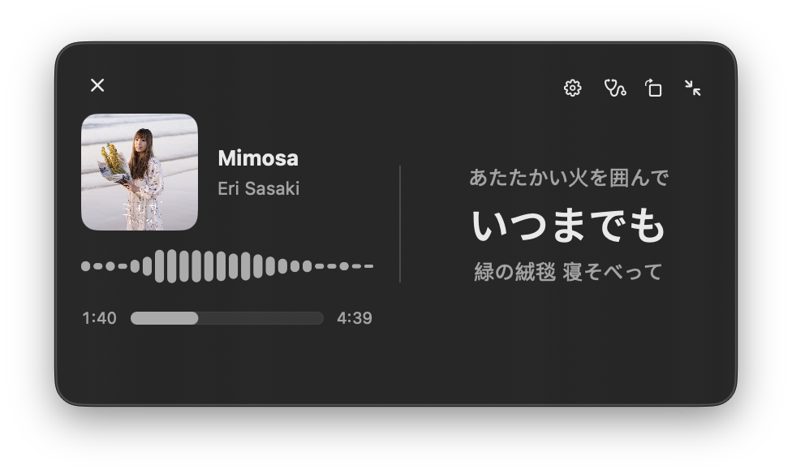

# dynasic



`dynasic` is a native macOS lyrics overlay for Apple Music.
It observes standalone Music.app playback through Apple Events and can render a real-time 24-band spectrum through a Core Audio process tap.
`LyricsCore` is an independently testable Swift package with cache-first lyrics providers and an LRCLIB fallback.

## Requirements

- Apple Silicon Mac running macOS 14.2 or later

## Install

1. Download `dynasic.zip` from the project's GitHub Releases page.
2. Unzip it and move `dynasic.app` to the Applications folder.
3. Open `dynasic.app` from Applications.

macOS may request Apple Music automation and audio-capture permissions when those features are first used.
Release builds are not Developer ID-signed or notarized, so macOS may require approval in System Settings > Privacy & Security.

## Release

GitHub Actions tests, builds, and publishes `dynasic.zip` when a `v*` tag is pushed.

```sh
git tag v0.1.0
git push origin v0.1.0
```
